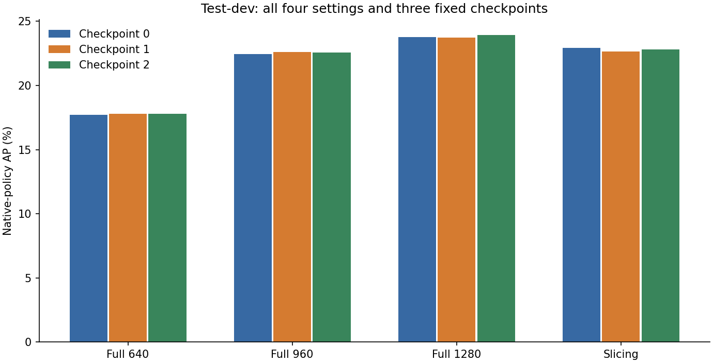
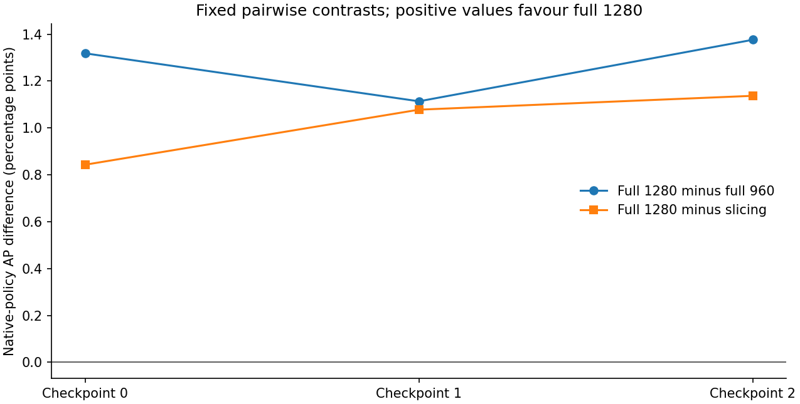

# Post hoc native-policy scoring on retained test-dev detections

By Ziad Ismail | Technical evaluation; not peer reviewed

## Question and fixed predictions

Does the primary test-dev ordering persist under the captured legacy VisDrone native-source scoring policy? This is a later post hoc sensitivity check: the primary converted results were already known. The scope was fixed before this branch's scoring, but that does not make it a blind test or external preregistration.

All three existing YOLO11n checkpoints and four unchanged inference settings use all 1,610 VisDrone2019-DET test-dev images. The 19,320 retained image/setting records were checked for complete identity, geometry and ordering. No new detector inference, retraining, confidence/NMS/tile tuning or checkpoint selection was performed.

## What the scoring policy changes

The native policy preserves the captured source's category-0 union-mask filtering, ignored-object matching, global detection caps before selecting a category, class-image weighting, exact IoU thresholds and continuous precision-envelope integration. AP uses up to 500 retained detections per image. Category 11 is not promoted to the category-0 mask. These bundled semantics differ from the converted evaluator, so native AP minus converted AP is not a detector improvement or a causal estimate of masking alone.

[Per-class exports](results/testdev_native/per_class_ap.json) retain the ten class AP values and the source's class-image weights. A class occurring in more images receives more aggregate weight; these are not object counts.

## Complete native result

All values are native-policy AP percent. All twelve full-split cells use the unchanged Python port.

| Checkpoint | Full 640 | Full 960 | Full 1280 | Fixed slices + global |
|---|---:|---:|---:|---:|
| 0 | 17.693737 | 22.453627 | 23.772046 | 22.928950 |
| 1 | 17.808420 | 22.607340 | 23.721115 | 22.643130 |
| 2 | 17.793292 | 22.573290 | 23.949571 | 22.812447 |

[All seven metrics](results/testdev_native/metrics.csv) include AP, AP50, AP75, AR1, AR10, AR100 and AR500. Native and converted values have different definitions; their absolute levels are not interchangeable.

| Checkpoint | Full 1280 minus 960, AP points | Full 1280 minus slicing | Slicing minus 960 |
|---|---:|---:|---:|
| 0 | +1.318419 | +0.843096 | +0.475323 |
| 1 | +1.113775 | +1.077985 | +0.035791 |
| 2 | +1.376281 | +1.137123 | +0.239158 |

Full 1280 is highest for every checkpoint. The native order is 1280 > slicing > 960 > 640, compared with 1280 > 960 > slicing > 640 under the primary converted metric. The close secondary ordering therefore reverses in all three checkpoints. The smallest slicing/960 margin is only 0.035791 points; no significance or universal ordering claim follows.

## Bounded publisher-function agreement

Before full scoring, the unchanged captured publisher MATLAB-language functions ran under GNU Octave 11.3.0 on the same three annotation-selected images for each of the twelve checkpoint/setting cells: 36 real cases. Selection used annotations rather than detection quality: the first image without category-0 regions, the remaining image with most category-0 rows, then the remaining image with most score-zero target rows, with fixed filename tie-breaking and fallbacks.

No score-zero target rows exist in these test-dev annotations, so the third criterion used its declared fallback. Do not interpret it as observed ignored-target stress coverage.

All filtered annotation/detection arrays passed absolute tolerance 1e-10 with no relative tolerance. All seven aggregate metrics passed tolerance 1e-8 percentage points. Maximum aggregate discrepancy was 2.1316282072803006e-14 percentage points; maximum filtered-array discrepancy was 1.1368683772161603e-13. This is purposeful bounded source agreement, not full-split publisher parity, exhaustive MATLAB-platform equivalence or an official challenge submission.

The [protocol presentation](protocols/testdev_native_sensitivity.json) and [validation summary](results/testdev_native/validation_summary.json) preserve the actual scope separately from the original frozen primary confirmation.

## Conclusion and limits

The leading setting survives this additional declared evaluation policy, while the closer slicing/960 comparison changes. The finding supports specifying the evaluator when making a recommendation. It does not establish a new detector, selector, statistical significance, independent scenes, blind/OOD generalisation, safe flight, onboard efficiency, annotation savings or peer review. No uncertainty interval was added.

The original converted results and frozen confirmation remain unchanged. The public update provides aggregate evidence, static figures and the technical report, not a new native-scoring adapter or the reference pipeline. Raw predictions, annotations, weights and captured source execution are not bundled.

Source policy: [VisDrone dataset](https://github.com/VisDrone/VisDrone-Dataset), [captured legacy DET toolkit](https://github.com/VisDrone/VisDrone2018-DET-toolkit). Source and licence credits remain in [THIRD_PARTY_NOTICES.md](THIRD_PARTY_NOTICES.md).
