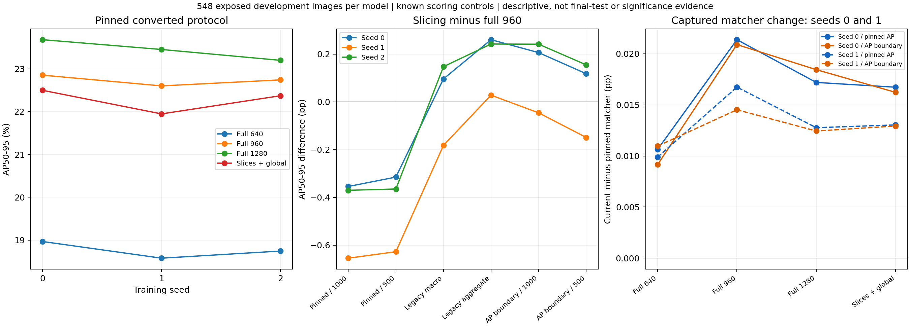
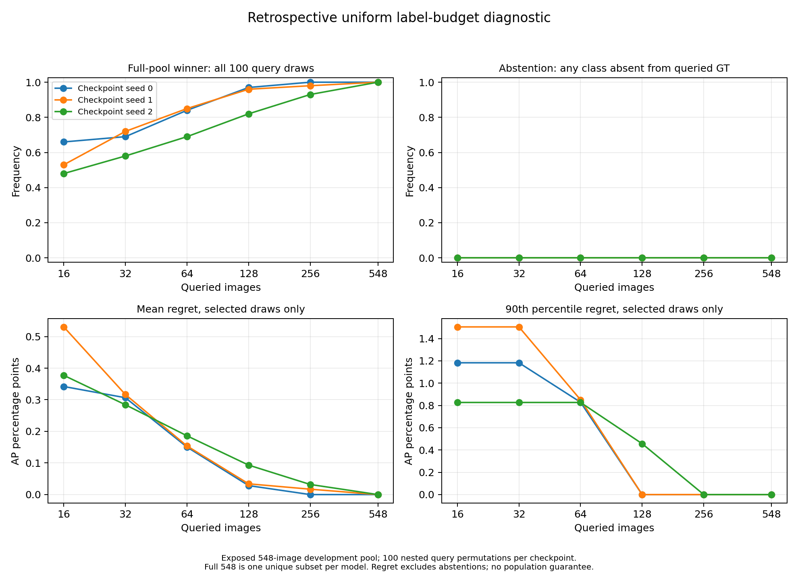

# UAV vision: resolution, slicing and evaluation sensitivity

By Ziad Ismail | Software release 0.6.0

I compare four established inference settings across three separately trained YOLO11n checkpoints on 548 VisDrone2019-DET development images (38,759 curated targets), followed by a frozen primary-metric confirmation on all 1,610 official test-dev images (75,102 converted targets). The study asks how resolution, slicing, processing cost and scoring conventions affect the conclusions supported by the same saved detections. It introduces no new detector or slicing method.

## Development comparison

| Setting | Seed 0 AP50-95 (%) | Fresh seed 1 AP50-95 (%) | Seed 2 AP50-95 (%) |
|---|---:|---:|---:|
| full_640 | 18.965968 | 18.576835 | 18.743138 |
| full_960 | 22.852199 | 22.601623 | 22.741985 |
| full_1280 | 23.680726 | 23.451961 | 23.198330 |
| fixed_slices_640_plus_global | 22.497980 | 21.947254 | 22.371823 |

These are pinned converted-task scores using Ultralytics 8.3.253. All four settings share a 640-trained checkpoint within each seed; weights differ between seeds. Full-frame inputs are 640/960/1280. Fixed slicing uses 640-pixel tiles, nominal 20% overlap, a global 640 pass and CPU class-aware merging. Inference is FP32, batch 1, square padding, confidence floor 0.001, single-label proposals, detector/merge NMS 0.7 and 1,000-output caps. This is not an exact SAHI/MRU reproduction or separately optimized training at each resolution.



Full 1280 has the highest AP in all 18 within-model comparisons across six declared scoring conventions. The close slicing/full-960 ordering changes with convention and seed: a known published AP boundary change reverses it for seeds 0 and 2, while seed 1 remains negative. The legacy source aggregate reverses it in all three. These are descriptive development findings, not a significance or universal ordering claim.

A separate control uses the reviewed matcher from captured upstream commit `abc2066dd6bd87f6806f73a170cf8f764ca2ebbe` on the same saved outputs for **seeds 0 and 1 only**. Its small score shifts are evaluator changes, not detector gains. The installed framework was not upgraded; the original scores are preserved. Related matching behavior and the AP integration change already have upstream reports/changes. No new bug or method is claimed.

## Completed test-dev confirmation

The same existing checkpoints and all four unchanged settings were evaluated without retraining or test-dev tuning. Full 1280 remains the highest-AP setting for all three checkpoints under the **primary converted metric**:

| Setting | Seed 0 AP50-95 (%) | Seed 1 | Seed 2 |
|---|---:|---:|---:|
| full_640 | 14.787737 | 14.981049 | 14.826275 |
| full_960 | 18.595000 | 18.804015 | 18.628206 |
| full_1280 | 19.260103 | 19.314283 | 19.485830 |
| fixed_slices_640_plus_global | 18.365783 | 18.419611 | 18.399213 |

Its registered advantage is 0.510–0.858 AP points over full 960 and 0.894–1.087 over slicing. Absolute full-1280 AP is 3.712–4.421 points below the same checkpoints on development. These are cross-split differences, not causal proof of overfitting or distribution shift. The full six-convention development suite was not repeated on test-dev. A separate later post hoc check applies the captured legacy native-source policy to the retained test-dev detections; its scope and findings are reported below.


Solid lines: test-dev; dashed: development. Existing checkpoints are not independent scene samples; no significance intervals are implied. Public test-dev labels were held out from this study, not a blind challenge. Scene grouping, near-duplicate absence and pretraining exposure remain unknown.

Read [complete confirmation results](TESTDEV_RESULTS.md), [protocol presentation](protocols/testdev_confirmation.json), [all twelve AP rows](results/testdev/ap_comparison.csv), [six contrasts](results/testdev/registered_contrasts.csv) and the [technical report](reports/Technical%20Report.pdf). The [portable test-dev component](testdev_execution/README.md) now supplies explicit preparation, inference and saved-output scoring interfaces. Its [validation record](testdev_execution/VALIDATION.md) separates complete real preparation and retained-log rescoring from a one-image CPU integration check. The later protocol presentation records the earlier internal plan; it is not external preregistration.

## Post hoc native-policy test-dev check

A separate check evaluated the same saved detections on all 1,610 images under the captured legacy VisDrone native-source policy. No detector inference, retraining, threshold tuning or checkpoint selection was repeated. Full 1280 remains highest for all three checkpoints, at 23.721–23.950% native AP. The close secondary comparison reverses: native scoring ranks 1280 > slicing > 960 > 640 for every checkpoint, whereas the primary converted metric ranks 1280 > 960 > slicing > 640.

Full 1280 exceeds full 960 by 1.114–1.376 native AP points and slicing by 0.843–1.137 points. The smallest slicing-minus-960 margin is only 0.035791 points; these observed orderings are not significance claims. Native and converted AP have different definitions, so the change in absolute score is not a detector improvement or a causal estimate of ignore masking.

All twelve full-split cells use the unchanged Python native-policy port. Before full scoring, the captured publisher MATLAB-language functions ran under GNU Octave 11.3.0 on the same three annotation-selected images for each checkpoint/setting: 36 real cases. Filtered arrays and all seven aggregate metrics passed the fixed numerical tolerances. This is bounded source agreement, not full-split publisher parity or an official challenge result. No score-zero target rows were present, so the third selection criterion used its declared fallback.

Read the [complete native results](NATIVE_TESTDEV_RESULTS.md), [all seven metrics](results/testdev_native/metrics.csv), [per-class AP and weights](results/testdev_native/per_class_ap.json) and [post hoc protocol presentation](protocols/testdev_native_sensitivity.json). This branch adds aggregate evidence and figures; its native/reference execution pipeline is not distributed.

## Additional seed-0 development evidence

At confidence >= 0.25 / IoU >= 0.50, slicing matches more targets in every declared original-area bin, but converted-task precision is 44.22% versus 62.35% for full 1280. This fixed numerical threshold is not calibrated or equal-precision evaluation. The size plot/data remain **seed 0 only** and use the pinned matcher; they are GT recall bins, not size AP. The two additional seeds do not silently extend this result.

Two additional seed-0 inference sweeps reproduced every saved prediction exactly while timings drifted. Later training-seed sweeps also have different timing levels. Desktop median times are not stable speedups, energy/FLOP measurements or onboard-flight performance.

## Evidence and limits

All three 150-epoch training runs completed, selecting epochs 95/103/114 on exposed validation. Failed seed-1 run b002 stopped at epoch 60 and is preserved as incomplete; its fresh replacement used unchanged seed-1 settings from the original pretrained weights. Three completed seeds do not make validation untouched or establish population significance. The separate frozen test-dev confirmation does not establish blind, scene-independent, field-safety or peer-reviewed performance.

On development data, the legacy scoring port agrees with unchanged captured publisher functions under Octave 11.3.0 on all four seed-0 settings and all 548 images, including filtered arrays and seven metrics. Full development reference execution was not repeated for seeds 1/2. The later test-dev branch has a separate 36-case source gate across all three checkpoints; its twelve full-split results come from the Python port. Neither check establishes exhaustive MATLAB-platform equivalence or an official challenge submission.

This repository includes source, synthetic CPU controls, settings, aggregate JSON/CSV, separate development/test-dev rendering programs and explicit-input portable execution. No images, labels, raw detections, per-object records, weights, captured toolkit or executable native/current-matcher reference branch is bundled. Native/reference/current-matcher numerical controls remain **aggregate-only**. Test-dev execution source is supplied, with complete real preparation, 19,320 retained rows rescored and one-image CPU integration checked. Fresh installation, actual prospective training and a complete new portable inference sweep remain unverified.

Read [result definitions](RESULTS.md), [reproduction scope](REPRODUCING.md), [data policy](DATA.md), [notices](THIRD_PARTY_NOTICES.md) and [preparation](READ_FIRST.md).

```console
python -B -m unittest discover -s tests -v
python -B src/render_aggregate_results.py
python -B src/render_testdev_results.py --input-dir results/testdev --output-dir artifacts/testdev_render
```

These commands run the root synthetic controls and render bundled aggregates. The test-dev renderer validates and reconstructs tables/figures; it performs no inference or AP recomputation. Output directories must be new. No data are downloaded.

## Portable and label-budget execution scope

The [portable component](portable_execution/README.md) connects explicit verified dataset paths/bindings to prospective training, completion review, inference and saved converted scoring. It removes the old generated-manifest dependency for new runs while retaining exact launch-byte resume checks. The original study retains its historical provenance. A bounded CPU preflight/certificate/one-image four-setting inference/rescore run verifies plumbing; no fresh 150-epoch training or full portable benchmark rerun is claimed. [Validation scope](PORTABLE_VALIDATION.md).

The separate [test-dev component](testdev_execution/README.md) passes 62 synthetic/CPU controls. All 1,610 raw image/annotation pairs were prepared and verified; the same pinned scorer recovered all twelve complete historical method summaries from the three retained 6,440-row logs. A new seed-0 run covered only the first sorted image with all four settings on CPU and passed run verification. These are scoped software checks, not new detector results or an independent evaluator.

The [label-budget diagnostic](label_budget/RESULTS.md) completes 100 frozen query orders at six budgets across three checkpoints, using the already exposed 548-image pool. [Protocol and preparation](label_budget/READ_FIRST.md), [aggregates](results/label_budget/label_budget_results.csv). Full 548 is one unique subset per checkpoint. These curves measure finite-pool query variability; they do not establish new-scene generalisation, annotation savings or active-method novelty.



Root src/ contains preserved historical study adapters and aggregate renderers; use portable_execution/ for prospective training/development execution and testdev_execution/ for explicit test-dev preparation, inference and saved-output scoring. Label-budget source/controls and aggregates are supplied, while real full-grid historical-input orchestration and private prediction caches remain outside this release. Read the scoped commands before running workloads. The repository accompanies an empirical development study, a frozen primary test-dev confirmation and a later post hoc native-policy sensitivity check. The scientific results are not peer reviewed.

## References

- VisDrone authors, [dataset repository](https://github.com/VisDrone/VisDrone-Dataset) and [Detection and Tracking Meet Drones Challenge](https://arxiv.org/abs/2001.06303).
- [Ultralytics 8.3.253](https://github.com/ultralytics/ultralytics/tree/v8.3.253) and [YOLO11](https://docs.ultralytics.com/models/yolo11/).
- Akyon, Altinuc and Temizel, [SAHI, ICIP 2022](https://arxiv.org/abs/2202.06934), [MIT software](https://github.com/obss/sahi).
- [MRU author code](https://github.com/JiajunChen223/MRU-YOLO), related selective-inference work, not reproduced here.
- Known AP integration change: [PR 24175](https://github.com/ultralytics/ultralytics/pull/24175), [earlier discussion 8568](https://github.com/ultralytics/ultralytics/issues/8568).
- Known matching-order work: [PR 26616](https://github.com/ultralytics/ultralytics/pull/26616), merged 11 October 2026, and [issue 22583](https://github.com/ultralytics/ultralytics/issues/22583). [Captured validator](https://github.com/ultralytics/ultralytics/blob/abc2066dd6bd87f6806f73a170cf8f764ca2ebbe/ultralytics/engine/validator.py) defines this control; later upstream code may differ.

Code licence: AGPL-3.0-only, with upstream rights retained. This software release accompanies a controlled evaluation study. Its results are not peer reviewed, and it is not a production-readiness certification.
