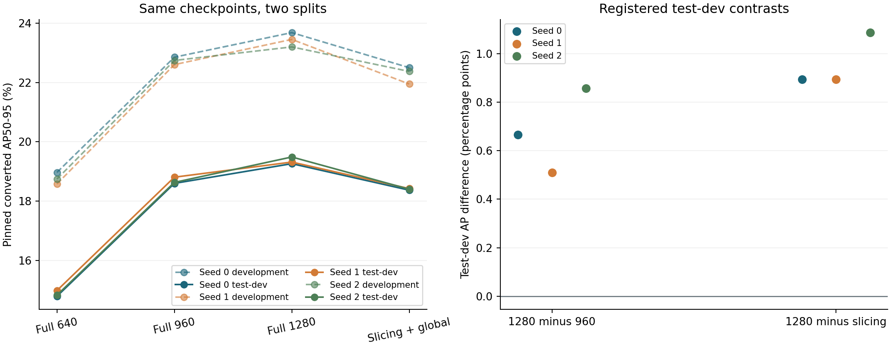

# Frozen test-dev confirmation

By Ziad Ismail | 18 October 2026 | Technical evaluation; not peer reviewed

## Question and fixed comparison

Does the primary development ordering persist on official VisDrone2019-DET test-dev when the existing models and inference settings are unchanged? All 1,610 images, four settings and three already selected checkpoints were evaluated. There was no retraining, checkpoint reselection or confidence/NMS/resolution/tile tuning on test-dev.

The [public protocol presentation](protocols/testdev_confirmation.json) describes an earlier internal plan created at 02:56:55 UTC on 18 October, with a pre-acquisition scope clarification at 02:57:17 UTC. Existing development results and a small label-budget pilot were known. The original internal record digests are retained; this later sanitised presentation has different bytes. It is not external preregistration or an earlier public registration.

The model is established YOLO11n, trained for 150 epochs at input 640. Selected development epochs are 95/103/114. Weights are shared across settings within each checkpoint. Inference is FP32/batch 1/square padding, confidence floor 0.001, detector and merge NMS 0.7, single highest-scoring class per proposal and 1,000-output caps. The slicing route uses 640-pixel tiles, nominal 20% overlap and a global 640 pass. This is not an exact SAHI-author reproduction or comparison of separately optimised training resolutions.

## Complete primary result

Values are pinned Ultralytics 8.3.253 converted ten-class pooled AP50-95 **percent**. Ignored native annotations are retained separately but the converted scorer does not apply native ignore-region masking. These are not official native challenge scores or averages of image AP.

| Checkpoint | Full 640 | Full 960 | Full 1280 | Fixed slices + global |
|---|---:|---:|---:|---:|
| Seed 0 | 14.787737 | 18.595000 | 19.260103 | 18.365783 |
| Seed 1 | 14.981049 | 18.804015 | 19.314283 | 18.419611 |
| Seed 2 | 14.826275 | 18.628206 | 19.485830 | 18.399213 |

| Checkpoint | 1280 minus 960, AP points | 1280 minus slicing, AP points |
|---|---:|---:|
| Seed 0 | +0.665104 | +0.894320 |
| Seed 1 | +0.510268 | +0.894672 |
| Seed 2 | +0.857625 | +1.086618 |

Full 1280 remains highest among these four settings for all three checkpoints under the primary converted metric. All six registered contrasts are positive. [All twelve full-precision AP rows](results/testdev/ap_comparison.csv) include development scores and test-dev-minus-development differences; [all six contrasts](results/testdev/registered_contrasts.csv) use full precision before rounding.

Solid lines are test-dev, dashed lines development. Points identify existing checkpoints, not independent scene samples. The right panel contains the six registered contrasts, without population confidence intervals. [SVG figure](figures/testdev_development_comparison.svg).

Absolute AP is lower on test-dev for every setting/checkpoint. Full-1280 development-minus-test-dev differences are 4.420623/4.137678/3.712500 AP points for seeds 0/1/2. These are **same-checkpoint cross-split differences**, not paired-image observations or proof that overfitting or distribution shift caused the drop. The development range 23.198–23.681% becomes 19.260–19.486% on test-dev. The ordering persists while absolute performance declines.

## Data and execution evidence

[Data integrity summary](results/testdev/data_integrity_summary.json): 1,610 source pairs, 77,547 native rows, 75,102 converted targets and 2,445 excluded records. Conversion has zero new malformed exceptions, clipping or duplicate removals. Converted labels and exclusion sidecars were independently reconstructed byte-for-byte; copied-image hashes and dimensions were independently verified. Exact-byte cross-split duplicate image groups are zero; near duplicates, shared scenes and pretraining exposure remain unresolved. No verified scene map is available.

All three runs completed with exit 0. The [validation summary](results/testdev/validation_summary.json) records 19,320 image/setting rows and 48,834 detector passes, plus 15 warmups per checkpoint. A separate CPU execution of the same pinned scorer reproduces all twelve complete summaries exactly; this is independent execution, not a second evaluator implementation or external scientific validation. No flagged warning/error/NMS-time-limit console line was found.

The 54 listed protected inputs match their recorded checkpoint before and after the final audit. That checkpoint was captured after launch while seed 0 was running, before any test-dev summary; it does not backdate protection or cover every historical artifact. The sanitised validation summary gives the exact category counts and limits.

## Processing cost and timing

Each full-frame setting makes 1,610 passes per checkpoint. Slicing plus global makes 11,448: 7.110559 times full-640 square-input pixels, or 1.777640 times full 1280. The development slicing ratio was 6.186 because image dimensions and resulting tile counts differ. Full 1280 has both greater AP and fewer square-input pixels than this fixed slicing route here; pixel count is not FLOPs, energy or a general efficiency frontier.

[All twelve diagnostic cost rows](results/testdev/diagnostic_costs.csv) report passes, pixels and median/p95 milliseconds from one cached desktop sweep per checkpoint. Full-1280 median times are 16.1718/18.9418/31.3909 ms, versus slicing 61.99655/72.10500/137.60685 ms. This substantial drift prevents a stable speedup, onboard deadline or seed-caused runtime claim. The timing boundary includes JPEG decode, view construction, detector processing/transfers and CPU merge, excluding artifact writing and metric calculation.

## Scope and next decision

Test-dev labels are public but held out from this investigation's development decisions. The official split and byte disjointness do not establish a blind challenge, independent scenes, OOD performance or independent external validation. No population significance, calibrated uncertainty, annotation saving, learned-selector gain, robot integration or flight performance is established.

Only primary pinned converted scoring was executed for this confirmation. The [six-convention development controls](RESULTS.md), seed-0 exact publisher-reference parity, two-seed current-matcher control, seed-0 size diagnostic and retrospective development label-budget result remain distinct. They are not test-dev controls by association. Any further test-dev exploration is exploratory and must not be retroactively folded into the frozen confirmation.

This strengthens a bounded evaluation conclusion: the simple larger full-frame control remains stronger than the particular fixed slicing route tested. The result supplies no demonstrated need to add a learned selector to this four-setting split-level decision. A new method needs a meaningful decision endpoint/cost, a recoverable failure, strong simple alternatives and close prior-work analysis. No novel detector, universal resolution rule or publication-level originality is established.

## What can be reproduced from this release

The new branch supplies three aggregate CSV files, the verified PNG/SVG, derived data/protocol/validation summaries and the [technical report](reports/Technical%20Report.pdf). It does **not** supply the internal test-dev adapter, raw predictions, data, labels, weights or full audit/orchestrator. The existing aggregate renderer does not render the new test-dev figure or recompute these AP scores. [Reproduction scope](REPRODUCING.md) separates aggregate inspection from detector/scorer reproduction. Existing executable source and tests are unchanged in version 0.4.0.

Prior methods and software: [VisDrone dataset](https://github.com/VisDrone/VisDrone-Dataset), [Ultralytics 8.3.253](https://github.com/ultralytics/ultralytics/tree/v8.3.253), [SAHI](https://arxiv.org/abs/2202.06934). Licence and source credits remain in [notices](THIRD_PARTY_NOTICES.md).
